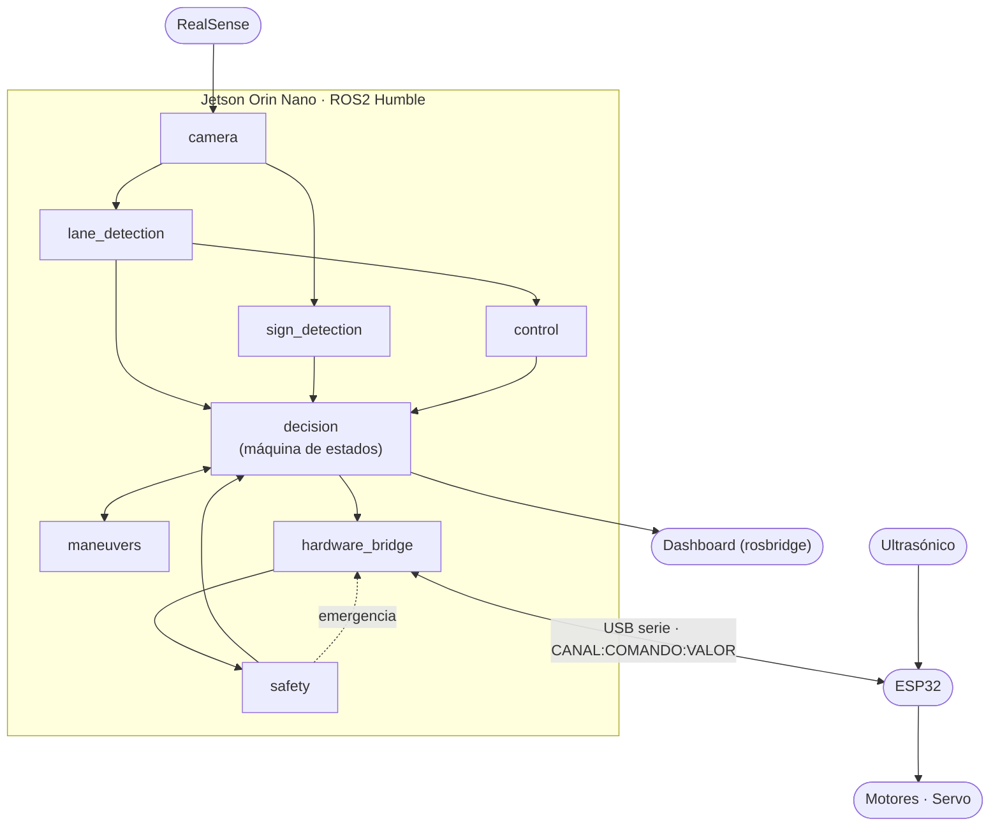

# Arquitectura del sistema

Fuente única de la arquitectura del vehículo. Si otro documento la contradice, este tiene razón y el otro se corrige. Las decisiones puntuales se registran como ADR en [`adr/`](adr/).

## 1. Alcance

El sistema es un vehículo autónomo a escala 1:10 con dos equipos:

- **Jetson Orin Nano** (Ubuntu 22.04, ROS2 Humble): percepción, decisión y control.
- **ESP32** (único microcontrolador): motores vía puente H, dirección por servo y sensor ultrasónico.

Se comunican por **un único enlace serial**. El hardware está en el [ADR-0001](adr/0001-hardware-de-control-y-protocolo-serial.md) y el protocolo, que es el del firmware de `Bosch-Aura/embedded`, en el [ADR-0002](adr/0002-protocolo-serial-del-firmware-embedded.md).

El sistema funciona sin internet. Ninguna parte de la conducción depende de un servicio externo.

## 2. Principios

Todo nodo nuevo los respeta. Los revisores los usan como criterio de review.

1. **Un nodo, una responsabilidad.** Si un nodo necesita explicarse con "y", son dos nodos.
2. **Los nodos se comunican solo por mensajes.** Ningún paquete importa código de otro. Lo que comparten son tipos de mensaje.
3. **Los sensores no deciden.** Percepción y seguridad publican hechos. Solo `bfmc_decision` decide qué hace el auto.
4. **Un único escritor del puerto serial** (`bfmc_hardware_bridge`) y **un único publicador de `/cmd/drive`** (`bfmc_decision`).
5. **Unidades SI dentro de ROS** (m/s, rad, m). La conversión al formato del ESP32 ocurre solo en el bridge.
6. **Nada hardcodeado.** Umbrales, ganancias, tiempos y nombres de topics son parámetros de un YAML por paquete.
7. **El tiempo se puede simular.** La lógica recibe el instante actual como argumento y no llama a `time.sleep` ni lee el reloj por su cuenta, para poder testear una maniobra de 8 segundos en milisegundos.

## 3. Vista general



Los nombres van sin el prefijo `bfmc_`: el paquete real de `camera` es `bfmc_camera`.

## 4. Paquetes

| Paquete | Responsabilidad | Se suscribe a | Publica |
|---|---|---|---|
| `bfmc_interfaces` | Mensajes y acciones propios del proyecto. | — | — |
| `bfmc_camera` | Entrega color y profundidad de la RealSense. | — | `/camera/color/image_raw`, `/camera/depth/image_rect_raw` |
| `bfmc_lane_detection` | Imagen → estado del carril. No calcula comandos. | `/camera/color/image_raw` | `/perception/lane` |
| `bfmc_sign_detection` | Detecta señales con YOLO y estima su distancia. No ejecuta maniobras. | `/camera/color/image_raw`, `/camera/depth/image_rect_raw` | `/perception/signs` |
| `bfmc_control` | Estado del carril → ángulo de dirección (PID con filtro). | `/perception/lane` | `/control/lane_cmd` |
| `bfmc_maneuvers` | Ejecuta una maniobra puntual (stop, intersección) cuando se la piden. Patrón Strategy: una clase por maniobra. | — | `/maneuver/cmd`, action `ManeuverExecute` |
| `bfmc_safety` | Decide si el obstáculo exige parada. No frena por sí mismo. | `/hardware/ultrasonic` (hoy nadie lo publica, ver ADR-0002) | `/safety/status` |
| `bfmc_decision` | Único nodo que decide. Arbitra por prioridad y publica el comando final. | `/perception/lane`, `/perception/signs`, `/safety/status`, `/control/lane_cmd`, `/maneuver/cmd`, `/hardware/status` | `/cmd/drive`, `/vehicle/state` |
| `bfmc_hardware_bridge` | Único dueño del puerto serial. Traduce unidades, envía comandos y publica lo que reporta el ESP32. | `/cmd/drive`, `/safety/status` | `/hardware/status`, servicio `/hardware/arm` |
| `bfmc_bringup` | Launch files y parámetros de todo el sistema. | — | — |

El dashboard vive en `frontend/`. Se conecta por `rosbridge_websocket`, solo lee `/vehicle/state` y no arranca ni controla nodos.

## 5. Contratos

| Interfaz | Tipo | Quién publica |
|---|---|---|
| `/camera/color/image_raw` | `sensor_msgs/Image` | camera |
| `/camera/depth/image_rect_raw` | `sensor_msgs/Image` | camera |
| `/perception/lane` | `bfmc_interfaces/LaneState` | lane_detection |
| `/perception/signs` | `bfmc_interfaces/SignDetectionArray` | sign_detection |
| `/control/lane_cmd` | `ackermann_msgs/AckermannDriveStamped` | control |
| `/maneuver/cmd` | `ackermann_msgs/AckermannDriveStamped` | maneuvers (solo mientras hay una maniobra activa) |
| `ManeuverExecute` | Action de `bfmc_interfaces` | server: maneuvers; cliente: decision |
| `/safety/status` | `bfmc_interfaces/SafetyStatus` | safety |
| `/hardware/ultrasonic` | `sensor_msgs/Range` | nadie por ahora: el firmware no informa distancias (ADR-0002) |
| `/hardware/status` | `bfmc_interfaces/HardwareStatus` | hardware_bridge |
| `/hardware/arm` | Servicio `std_srvs/Trigger` | server: hardware_bridge. Rearma el ESP32 después de un FAULT |
| `/cmd/drive` | `ackermann_msgs/AckermannDriveStamped` | decision (único) |
| `/vehicle/state` | `bfmc_interfaces/VehicleState` | decision |

Convenciones:

- Velocidad en m/s, ángulo de dirección en rad (positivo a la izquierda), distancias en m.
- Se usan tipos estándar (`sensor_msgs`, `ackermann_msgs`) siempre que alcancen. Los tipos propios viven solo en `bfmc_interfaces`, y sus campos se definen en el PR que los crea.

## 6. Prioridad de decisión

En cada ciclo `bfmc_decision` elige una sola fuente para `/cmd/drive`, de mayor a menor prioridad:

1. **Emergencia.** Obstáculo cercano, comunicación perdida con el ESP32 o `/safety/status` inválido: parada.
2. **Maniobra activa.** Si hay una maniobra en curso, se usa `/maneuver/cmd` y se ignora el carril.
3. **Evento de señal o intersección.** Se inicia la maniobra correspondiente.
4. **Seguir carril.** Se reenvía `/control/lane_cmd`. Es el comportamiento por defecto.

Las dos detecciones de intersección (por señal y por geometría del carril) entran como eventos al mismo árbitro.

## 7. Seguridad

- **Watchdog en el ESP32:** en modo AUTO, si pasan 300 ms sin un comando válido de la Jetson, frena, centra la dirección y queda en FAULT hasta que lo rearmen. Funciona aunque se caiga todo el software de la Jetson.
- **Frenado por obstáculo en el ESP32:** el firmware frena y entra en FAULT por su cuenta si el ultrasónico detecta algo cerca.
- **Defensa en profundidad:** `bfmc_hardware_bridge` también escucha `/safety/status` y frena si indica emergencia, sin pasar por `bfmc_decision`.
- La seguridad no depende del dashboard ni de ningún cliente de red.

## 8. Estructura de un paquete

Todo paquete Python sigue esta forma. La skill `nuevo-nodo` la genera.

```
bfmc_<funcionalidad>/
├── bfmc_<funcionalidad>/
│   ├── __init__.py
│   ├── <nombre>_logic.py     # lógica pura: sin rclpy ni hardware, el tiempo entra como argumento
│   └── <nombre>_node.py      # envoltorio ROS: parámetros, subscripciones, publicaciones
├── config/params.yaml        # todos los parámetros y sus valores por defecto
├── launch/<nombre>.launch.py
├── test/                     # tests de la lógica, del nodo y de estilo
├── resource/bfmc_<funcionalidad>
├── package.xml
├── setup.py
├── setup.cfg
└── README.md                 # qué hace, topics, parámetros, cómo probarlo
```

- La lógica pura se testea sin ROS. El nodo solo conecta mensajes con esa lógica.
- Cada paquete documenta sus topics y parámetros en su propio `README.md`.

## 9. Fuera de la primera iteración

- **Dashboard:** conexión por `rosbridge_websocket`. No bloquea la conducción.
- **Maniobras de cruce peatonal, estacionamiento y rotonda:** primero stop e intersección.
- **Estimación y verificación en el auto:** los valores del protocolo marcados como asumidos en el ADR se confirman al probar en la Jetson.

## 10. Verificación

Cualquier cambio se verifica con los mismos comandos que corre el CI (ver `README.md`). Lo que depende del auto real (puerto serial, cámara, latencias) no se puede verificar en el CI y debe declararse como pendiente en el PR.
