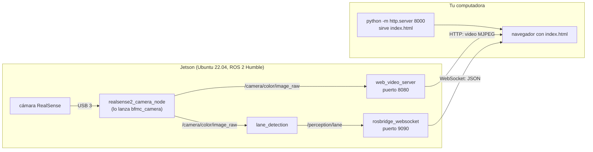
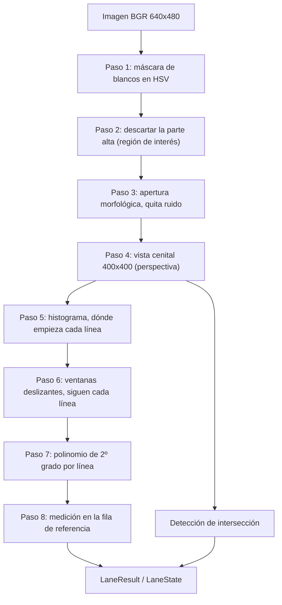

# Cámara, detección de carril y visor de calibración

Explicación completa del código que se probó junto en la Jetson: el paquete de la cámara (`bfmc_camera`), el de detección de carril (`bfmc_lane_detection`) y el visor de calibración (`frontend/visor-calibracion/`). Sirve para entender qué hace cada archivo, cómo viaja la imagen desde la cámara hasta el navegador y cómo calibrar la detección.

> **De qué código habla.** Describe el código de las ramas `feature/A2-136-camera`, `feature/A2-140-lane-detection` y `feature/A2-147-visor-de-calibracion` (los PRs de la cámara, del carril y del visor), que se juntaron en la rama de prueba `prueba-jetson`. Mientras esos PRs no estén en `main`, los archivos que se nombran acá solo existen en esas ramas. `bfmc_interfaces` (los mensajes) ya está en `main`.

## 1. Resumen

| Pregunta | Respuesta |
|---|---|
| ¿Qué hace `bfmc_camera`? | Lanza el driver oficial de la RealSense con la configuración del proyecto. **No tiene código propio.** |
| ¿Qué hace `bfmc_lane_detection`? | Convierte cada imagen de la cámara en el estado del carril: desvío lateral, error de rumbo, confianza e intersección. **No calcula comandos.** |
| ¿Usa algún modelo de aprendizaje? | **No.** Ni red neuronal, ni YOLO, ni modelo entrenado. Es visión clásica con OpenCV y NumPy, con parámetros escritos a mano en un YAML. El único modelo del proyecto es el YOLO de las señales, que está en `bfmc_sign_detection` (otro paquete, otro PR). |
| ¿Qué es el visor? | Una página de un solo archivo que se abre en el navegador de una computadora y muestra la imagen de la cámara, los datos del carril y un trapecio arrastrable para calibrar `warp_src`. Es de solo lectura. |
| ¿Cómo se ve la imagen en la computadora? | `web_video_server` (en la Jetson) la sirve como video MJPEG por HTTP, y la página la muestra con una etiqueta ``. Los datos del carril llegan por otro canal: `rosbridge` (WebSocket). |
| ¿Qué falta? | Calibrar con la pista real. Con la configuración actual, el detector da "carril detectado" apuntando a una habitación: los valores no están calibrados. |

## 2. Mapa de carpetas

```
autonomous-vehicle-BFMC-ros2/
├── ros2_ws/src/
│   ├── bfmc_interfaces/            # los mensajes del sistema (ya en main)
│   │   ├── msg/LaneState.msg       #   el que publica la detección de carril
│   │   └── ...                     #   (SignDetection, SafetyStatus, etc.: no se usan acá)
│   ├── bfmc_camera/                # configura el driver de la RealSense
│   │   ├── config/params.yaml
│   │   ├── launch/camera.launch.py
│   │   ├── test/
│   │   ├── package.xml, setup.py, setup.cfg, resource/
│   │   └── README.md
│   └── bfmc_lane_detection/        # imagen -> estado del carril
│       ├── bfmc_lane_detection/
│       │   ├── lane_detection_logic.py
│       │   ├── lane_detection_node.py
│       │   └── image_utils.py
│       ├── config/params.yaml
│       ├── launch/lane_detection.launch.py
│       ├── test/
│       ├── package.xml, setup.py, setup.cfg, resource/
│       └── README.md
└── frontend/visor-calibracion/     # el visor
    ├── index.html
    ├── calibrar.sh
    └── README.md
```

Las carpetas `build/`, `install/` y `log/` de `ros2_ws/` las genera `colcon build`; no se suben a git (están en `.gitignore`).

### Qué es cada archivo

**`bfmc_camera`**

| Archivo | Para qué sirve |
|---|---|
| `launch/camera.launch.py` | Arranca el nodo `realsense2_camera_node` del driver oficial, con el nombre `camera` y sin espacio de nombres, y le pasa el YAML. |
| `config/params.yaml` | Parámetros del driver: qué flujos se habilitan, resolución y cuadros por segundo, alineación de la profundidad. |
| `test/test_launch.py` | Comprueba la configuración sin necesitar la cámara (ver sección 4). |
| `test/test_flake8.py` | Revisa el estilo del código Python. |
| `package.xml` | Ficha del paquete: nombre, mantenedor y dependencias (`realsense2_camera`, `launch`, `launch_ros`). |
| `setup.py`, `setup.cfg`, `resource/bfmc_camera` | Empaquetado de Python para ROS: instalan el launch y el YAML y registran el paquete. |

**`bfmc_lane_detection`**

| Archivo | Para qué sirve |
|---|---|
| `bfmc_lane_detection/lane_detection_logic.py` | El algoritmo, **sin ROS**. Recibe una imagen y devuelve un `LaneResult`. Es lo que se explica en la sección 6. |
| `bfmc_lane_detection/lane_detection_node.py` | El nodo de ROS 2: recibe las imágenes, llama a la lógica y publica `LaneState`. |
| `bfmc_lane_detection/image_utils.py` | Convierte un mensaje `sensor_msgs/Image` en un arreglo de NumPy, a mano, sin `cv_bridge`. |
| `config/params.yaml` | Todos los parámetros del algoritmo. El código no tiene valores por defecto. |
| `launch/lane_detection.launch.py` | Arranca el nodo con ese YAML. |
| `test/test_lane_detection_logic.py` | Prueba el algoritmo con carriles sintéticos de posición conocida. |
| `test/test_lane_detection_yaml.py` | Prueba el algoritmo con la geometría real del YAML. |
| `test/test_lane_detection_node.py` | Prueba el nodo: publica una imagen y espera un `LaneState`. |
| `test/test_image_utils.py` | Prueba la conversión de imágenes. |
| `test/synthetic_lanes.py` | Ayudante que dibuja carriles de prueba. |
| `test/test_flake8.py` | Estilo. |

**`frontend/visor-calibracion`**

| Archivo | Para qué sirve |
|---|---|
| `index.html` | La página completa: HTML, estilos y JavaScript en un solo archivo. Corre en el navegador de la computadora. |
| `calibrar.sh` | Script que corre en la Jetson: compila el workspace si hace falta y lanza los cuatro procesos que necesita la página. |
| `README.md` | Cómo usarlo, advertencias de seguridad y qué está verificado. |

## 3. Cómo se conecta todo



Hay **dos canales independientes** entre la Jetson y el navegador:

| Canal | Qué viaja | Puerto | Protocolo | Lo sirve |
|---|---|---|---|---|
| Imagen | El video de la cámara | 8080 | HTTP, `multipart/x-mixed-replace` (MJPEG) | `web_video_server` |
| Datos | `LaneState` de `/perception/lane`, como JSON | 9090 | WebSocket, protocolo de `rosbridge` | `rosbridge_websocket` |

Si falla uno, el otro sigue. En las pruebas llegaron los datos del carril un buen rato antes de que apareciera la imagen.

### Topics y calidad de servicio

| Topic | Tipo | Publica | Lo lee | Calidad de servicio |
|---|---|---|---|---|
| `/camera/color/image_raw` | `sensor_msgs/Image` | driver de la RealSense | `lane_detection`, `web_video_server` | El driver publica en `RELIABLE` (se vio en la Jetson). `lane_detection` se suscribe en `BEST_EFFORT`, cola de 1. |
| `/perception/lane` | `bfmc_interfaces/LaneState` | `lane_detection` | `rosbridge` (y en el futuro `bfmc_control` y `bfmc_decision`) | `RELIABLE`, cola de 10 |

Una suscripción `BEST_EFFORT` acepta mensajes de un publicador `RELIABLE` o `BEST_EFFORT`. Lo contrario no: un suscriptor `RELIABLE` no recibe de un publicador `BEST_EFFORT`. Por eso `lane_detection` se suscribe como `BEST_EFFORT`: funciona con cualquier cámara.

### Qué corre dónde

| Dónde | Qué corre |
|---|---|
| **La Jetson** | El driver de la cámara, `lane_detection`, `web_video_server` y `rosbridge` (los lanza `calibrar.sh`). |
| **Tu computadora** | Un servidor web mínimo (`python -m http.server`) que solo entrega el archivo `index.html`, y el navegador, que ejecuta la página. **No hace falta ROS en tu computadora.** |

## 4. `bfmc_camera`: la cámara

El paquete no tiene código de captura: escribir otro driver sería reinventar uno que ya existe. Hace dos cosas: lanzar el driver oficial (`realsense2_camera`) y pasarle la configuración del proyecto.

### El launch

`launch/camera.launch.py` crea un único nodo: el paquete `realsense2_camera`, el ejecutable `realsense2_camera_node`, con el nombre `camera` y el espacio de nombres vacío. Ese nombre y ese espacio vacío son los que hacen que los topics salgan como `/camera/color/image_raw` y no como `/camera/camera/color/image_raw`.

### Los parámetros (`config/params.yaml`)

La clave de primer nivel (`camera`) es el nombre del nodo.

| Parámetro | Valor | Qué hace |
|---|---|---|
| `camera_name` | `camera` | Prefijo de los topics y de los marcos de referencia. |
| `initial_reset` | `false` | Si fuera `true`, reinicia la cámara al arrancar (útil si se cuelga). |
| `enable_color` | `true` | Publica la imagen de color. |
| `rgb_camera.color_profile` | `640x480x30` | Ancho x alto x cuadros por segundo del color. |
| `enable_depth` | `true` | Publica la profundidad. |
| `depth_module.depth_profile` | `640x480x30` | Ídem para la profundidad. |
| `align_depth.enable` | `true` | Publica la profundidad **alineada al color**, en `/camera/aligned_depth_to_color/image_raw`. La necesitará `bfmc_sign_detection` para medir la distancia a una señal en el píxel de la imagen de color. |
| `enable_sync` | `true` | Sincroniza los cuadros de color y de profundidad. |
| `publish_tf` | `false` | El sistema no usa las transformaciones de la cámara. |

La resolución de 640 x 480 se verificó en la Jetson (la imagen llegó a esa medida). Los 30 cuadros por segundo **no se midieron**.

### Los tests

`test/test_launch.py` verifica, sin necesitar la cámara:

- que el launch arranque el driver oficial;
- que los parámetros estén bajo el nombre del nodo;
- que el YAML se instale con el paquete;
- que se habiliten color y profundidad, y que la profundidad se alinee al color;
- que los perfiles tengan el formato `ancho x alto x fps`;
- **que cada parámetro exista en el driver**: lee el `rs_launch.py` instalado del driver y compara. Un parámetro mal escrito se ignoraría en silencio, y este test lo detecta.

## 5. `bfmc_interfaces`: el mensaje `LaneState`

Los nodos no se importan entre sí: se comunican por mensajes, y los tipos de esos mensajes viven en `bfmc_interfaces`. El que importa acá es `LaneState`:

| Campo | Tipo | Significado |
|---|---|---|
| `header` | `std_msgs/Header` | Instante de la medición: es el de la imagen de la que salió. |
| `detected` | `bool` | `false` si no se detectó el carril; entonces los demás campos no valen. |
| `lateral_error_m` | `float32` | Desvío lateral en metros. **Positivo: el centro del carril queda a la izquierda del auto** (hay que girar a la izquierda). |
| `heading_error_rad` | `float32` | Rumbo del carril respecto del auto, en radianes. **Positivo: el carril sigue hacia la izquierda.** |
| `confidence` | `float32` | De 0.0 a 1.0. |
| `intersection_detected` | `bool` | Hay una línea transversal (intersección) por delante. |

Convenciones de todo el sistema: unidades SI y positivo hacia la izquierda.

## 6. `bfmc_lane_detection`: el carril

### 6.1 El nodo (`lane_detection_node.py`)

El nodo es un envoltorio fino. Lo que hace, en orden:

1. **Declara los parámetros sin valor por defecto.** Si falta alguno en el YAML, el nodo falla al arrancar. Así no hay valores escondidos en el código.
2. **Arma el detector** (`LaneDetector`) con esos parámetros. Valida la configuración: valores fuera de rango o inconsistentes lanzan un error.
3. **Crea la suscripción y el publicador** con la calidad de servicio de la sección 3.
4. **En cada imagen** (`_on_image`): la convierte a BGR con `image_utils`, la pasa al detector y publica un `LaneState`. Copia el `header` de la imagen al resultado.
5. Si la imagen tiene una codificación no soportada, la descarta con una advertencia (a lo sumo una cada 5 segundos).

Cada imagen se procesa **sola**, sin memoria de las anteriores: no hay filtro temporal ni seguimiento. Si una imagen sale mal, el resultado de esa imagen sale mal.

### 6.2 `image_utils.py`

Convierte el mensaje de imagen de ROS en un arreglo de NumPy de alto x ancho x 3, en orden BGR (el que usa OpenCV). Soporta `bgr8` y `rgb8`; para `rgb8` invierte los canales. Respeta el `step` (bytes por fila), que puede incluir relleno. Se hace a mano, sin `cv_bridge`, para evitar esa dependencia y sus problemas de compatibilidad con NumPy. Rechaza las codificaciones que no soporta y los datos de tamaño incorrecto.

### 6.3 El algoritmo (`lane_detection_logic.py`)

No importa ROS. La clase `LaneDetector` recibe una imagen BGR y devuelve un `LaneResult` con los mismos campos que `LaneState`.



Los números de abajo son los de la configuración actual (`config/params.yaml`), con una imagen de 640 x 480.

**Paso 1. Máscara de blancos (HSV).** La imagen se pasa de BGR a HSV (tono, saturación, brillo) y se marcan los píxeles cuyo valor cae entre `white_hsv_min` `[0, 0, 200]` y `white_hsv_max` `[179, 60, 255]`: cualquier tono, poca saturación y mucho brillo. Es decir, "blanco". El resultado es una imagen en blanco y negro.

**Paso 2. Región de interés.** Con `roi_top_fraction: 0.5` se ponen en negro las primeras 240 filas de 480: la mitad de arriba (cielo, fondo) se ignora.

**Paso 3. Apertura morfológica.** Con `morph_kernel_px: 3` se aplica una apertura con un cuadrado de 3 x 3: elimina las manchas blancas de pocos píxeles (ruido) sin borrar las líneas.

**Paso 4. Vista cenital.** Una transformación de perspectiva "aplana" el piso, como si se lo mirara desde arriba. Se define con `warp_src`: cuatro puntos del piso en la imagen, como fracción del ancho y del alto, en este orden: arriba-izquierda, arriba-derecha, abajo-derecha, abajo-izquierda. Con el valor actual, `[0.30, 0.55, 0.70, 0.55, 1.00, 0.95, 0.00, 0.95]`, los puntos son (192, 264), (448, 264), (640, 456) y (0, 456) píxeles. Ese trapecio se estira hasta llenar una imagen cuadrada de `warp_width` x `warp_height` = 400 x 400 píxeles. En la vista cenital, las líneas paralelas del carril quedan paralelas y las distancias son uniformes. La matriz de la transformación se calcula una sola vez por tamaño de imagen.

**Paso 5. Dónde empieza cada línea.** En la mitad de abajo de la vista cenital (la más cercana al auto) se cuentan los píxeles blancos de cada columna. La mitad izquierda y la mitad derecha se tratan por separado: la columna con más píxeles de cada mitad es la base de la línea izquierda y de la derecha. Si la mejor columna tiene menos de `min_pixels: 50` píxeles, esa línea no existe.

**Paso 6. Ventanas deslizantes.** Para cada línea se recorre la vista cenital de abajo hacia arriba en `n_windows: 9` tramos de 44 píxeles de alto. En cada tramo se mira una ventana de `2 x window_margin_px` = 80 píxeles de ancho centrada en la posición actual. Se juntan los píxeles blancos de la ventana y, si hay al menos `min_pixels`, la ventana siguiente se recentra en el promedio de esos píxeles. Así la ventana "sigue" la línea aunque se curve.

**Paso 7. Polinomio.** Con todos los puntos juntos se ajusta un polinomio de segundo grado `x = a·y² + b·y + c` (la posición horizontal en función de la altura). Si hay menos de `min_pixels` puntos, o menos de 3 alturas distintas, la línea se descarta.

**Paso 8. Medición.** Se evalúa en una **fila de referencia**: `reference_row_fraction: 0.25` significa a un cuarto de la altura contando desde abajo, es decir `y = 300` de 400. Con `forward_range_m: 0.8` m en 400 píxeles (0,002 m por píxel en vertical), esa fila está a **0,2 m delante del auto**. En horizontal, `lane_width_m: 0.37` m en `lane_width_px: 200` píxeles da 0,00185 m por píxel: 10 píxeles de desvío son 1,85 cm.

- **Con las dos líneas**, si están separadas entre 0,5 y 1,5 veces el ancho esperado (entre 100 y 300 píxeles): el centro del carril es el punto medio, la pendiente es el promedio, y la confianza base es 1,0.
- **Si están más juntas o más separadas que eso**, una de las dos es ruido: se usa la que tiene más píxeles.
- **Con una sola línea**: el centro se estima sumando medio ancho de carril a la línea izquierda (o restándolo a la derecha), y la confianza base es 0,5.

Las fórmulas finales:

| Campo | Cómo se calcula |
|---|---|
| `lateral_error_m` | `(warp_width / 2 - centro) × metros_por_píxel_en_x`. El centro de la imagen cenital (columna 200) se toma como la posición del auto. Si el centro del carril queda a la derecha, da negativo. |
| `heading_error_rad` | `atan(pendiente × m_por_px_x / m_por_px_y)`. La pendiente es `dx/dy` en la fila de referencia. Si el carril sigue hacia la derecha, da negativo. |
| `confidence` | `confianza_base × min(1, píxeles / full_confidence_pixels)`, con `full_confidence_pixels: 1500`. Más píxeles de línea, más confianza. |

Si no se encuentra ninguna línea: `detected = false` y los demás campos en cero.

**Intersección.** Se mira la parte de abajo de la vista cenital (filas 200 a 400, la más cercana al auto). Una fila cuenta si al menos el 60 % de sus píxeles (240 de 400) es blanco. Si hay al menos `intersection_min_rows: 8` filas así, hay una franja horizontal que cruza el carril: `intersection_detected = true`. Es independiente de que se haya detectado el carril.

### 6.4 Lo que el algoritmo asume y no hace

- **Cada imagen se procesa sola.** No hay filtro temporal: el resultado puede saltar de un cuadro a otro.
- **Detecta "lo blanco", no "una línea".** Una pared blanca, una hoja o la ropa clara dentro del trapecio cuentan como línea. Con la configuración actual el detector dio `detected = sí` apuntando a una habitación.
- **El auto está en el centro de la imagen.** El desvío se mide respecto de la columna central. Si la cámara no está centrada en el auto, hay un error constante.
- **Plano.** La vista cenital supone un piso plano y que la cámara no se mueve respecto del auto.
- **Solo líneas blancas.** Las líneas de otro color se ignoran.
- **Todo está sin calibrar.** `warp_src`, los anchos y el umbral de color son una primera propuesta; dependen de la cámara, del montaje y de la luz.

### 6.5 Parámetros (`config/params.yaml`)

| Grupo | Parámetro | Valor | Unidad | Qué controla |
|---|---|---|---|---|
| Topics | `image_topic` | `/camera/color/image_raw` | — | De dónde lee la imagen |
| Topics | `lane_topic` | `/perception/lane` | — | Dónde publica |
| Color | `white_hsv_min` | `[0, 0, 200]` | H 0–179, S y V 0–255 | Mínimos para considerar un píxel blanco |
| Color | `white_hsv_max` | `[179, 60, 255]` | ídem | Máximos |
| Color | `morph_kernel_px` | 3 | px | Tamaño de la apertura que quita ruido (1 = sin apertura) |
| Imagen | `roi_top_fraction` | 0.5 | fracción de la altura | Cuánto de arriba se descarta |
| Imagen | `warp_src` | 8 valores | fracción del ancho y del alto | Los 4 puntos del piso que se aplanan |
| Imagen | `warp_width`, `warp_height` | 400, 400 | px | Tamaño de la vista cenital |
| Escala | `lane_width_m` | 0.37 | m | Ancho real del carril |
| Escala | `lane_width_px` | 200.0 | px | Ancho del carril en la vista cenital |
| Escala | `forward_range_m` | 0.8 | m | Distancia hacia adelante que cubre la vista cenital |
| Líneas | `n_windows` | 9 | — | Cantidad de ventanas deslizantes |
| Líneas | `window_margin_px` | 40 | px | Mitad del ancho de cada ventana |
| Líneas | `min_pixels` | 50 | px | Píxeles mínimos para dar una línea por válida |
| Medición | `reference_row_fraction` | 0.25 | fracción | Dónde se mide, contando desde el auto |
| Medición | `full_confidence_pixels` | 1500 | px | Píxeles con los que la confianza llega a 1 |
| Intersección | `intersection_band_top_fraction` | 0.5 | fracción | Desde dónde se mira la banda |
| Intersección | `intersection_row_fraction` | 0.6 | fracción | Cuánto de la fila tiene que ser blanco |
| Intersección | `intersection_min_rows` | 8 | filas | Filas necesarias |

### 6.6 Los tests

Los tests no necesitan la cámara ni la pista. Hay 47 funciones de test en este paquete (algunas con varios casos):

- **`test_lane_detection_logic.py`**: dibuja carriles sintéticos de posición conocida y comprueba el desvío y el rumbo con su signo, una sola línea, la confianza, la ausencia de carril, el ruido, las líneas no blancas o poco brillantes, la región de interés, la intersección y que una configuración inválida se rechace.
- **`test_lane_detection_yaml.py`**: usa la geometría real del YAML. Dibuja un carril en vista cenital, lo proyecta a la imagen de la cámara con la inversa de la misma transformación y comprueba que el detector recupere el desvío y el rumbo. Si alguien rompe la geometría del YAML, falla.
- **`test_lane_detection_node.py`**: levanta el nodo, publica una imagen y espera el `LaneState`. Comprueba el signo del desvío, el carril ausente, el encabezado, `rgb8` contra `bgr8` y las codificaciones no soportadas.
- **`test_image_utils.py`**: `bgr8`, `rgb8`, relleno al final de la fila y codificaciones o tamaños inválidos.

Lo que estos tests **no** pueden decir es si la configuración sirve con la cámara, la pista y la luz reales.

## 7. El visor de calibración

### 7.1 Cómo se ve la imagen en tu computadora

1. **La cámara** publica cuadros como mensajes ROS (`sensor_msgs/Image`). Un navegador no entiende ese formato.
2. **`web_video_server`**, en la Jetson, se suscribe al topic, convierte cada cuadro a JPEG y los manda uno tras otro por HTTP. La respuesta tiene el tipo `multipart/x-mixed-replace` con el separador `--boundarydonotcross`: es una secuencia de imágenes separadas por esa marca. Eso se llama MJPEG.
3. **El navegador**, con una etiqueta `` apuntando a esa dirección, reemplaza la imagen mostrada cada vez que llega una nueva parte. Por eso se ve como un video sin ningún JavaScript de por medio.
4. **La dirección** que arma la página es:
   `http://<IP>:8080/stream?type=mjpeg&qos_profile=sensor_data&topic=/camera/color/image_raw`
   - `type=mjpeg`: el formato.
   - `qos_profile=sensor_data`: pide la imagen con calidad de servicio "mejor esfuerzo", que sirve tanto con una cámara `RELIABLE` como con una `BEST_EFFORT`.
   - `topic=`: el topic. **Las barras van sin codificar**: `web_video_server` no decodifica `%2F`, y con las barras codificadas abre el stream pero no manda ningún cuadro (ver sección 8).

La página **solo muestra** el video; no lo procesa. El trapecio no está en la imagen: es un dibujo aparte (7.2).

### 7.2 El trapecio y el resto de la página

La imagen y el trapecio son dos capas apiladas en el mismo recuadro:

- Abajo, el `` con el video. Usa `object-fit: fill` y el recuadro mantiene la proporción 4:3.
- Arriba, un `<canvas>` del mismo tamaño, transparente, donde JavaScript dibuja el trapecio.

Las cuatro esquinas se guardan como **fracciones del ancho y del alto** (0 a 1), no como píxeles. Por eso no dependen del tamaño en que se muestre la imagen, y coinciden con las fracciones que espera `warp_src` en el YAML. Con el ratón se arrastra cada punto; la posición se limita a 0–1. Debajo, un cuadro de texto muestra siempre los ocho valores en el formato del YAML (`warp_src: [0.30, 0.55, ...]`), con un botón para copiarlos y otro para volver a los valores de `params.yaml`.

### 7.3 Los datos del carril

La página abre un WebSocket a `ws://<IP>:9090` y manda una única orden, la suscripción:

```json
{"op": "subscribe", "topic": "/perception/lane", "type": "bfmc_interfaces/msg/LaneState",
 "throttle_rate": 100, "queue_length": 1}
```

`rosbridge` devuelve cada mensaje como JSON. `throttle_rate: 100` limita a 10 mensajes por segundo, y `queue_length: 1` hace que, si la página se atrasa, vea siempre el último dato. La página escribe los campos en una tabla, dibuja una barra con la confianza y muestra cuánto hace que llegó el último dato (en rojo si pasaron más de 1000 ms). Si la conexión se corta, reintenta cada 3 segundos.

**Solo lectura:** el único `send` del código es esa suscripción. La página no publica ningún topic ni llama ningún servicio.

### 7.4 Las funciones de `index.html`

| Función | Qué hace |
|---|---|
| `restablecer()` | Vuelve el trapecio a los valores iniciales (los del `params.yaml`). |
| `textoWarp()` | Arma la línea `warp_src: [...]` con los ocho valores. |
| `ajustarCanvas()` | Hace que el canvas tenga el tamaño con que se muestra. |
| `dibujar()` | Dibuja el trapecio, los puntos numerados y actualiza el texto. |
| `posicionRelativa(e)` | Convierte la posición del ratón en fracciones del recuadro, limitadas a 0–1. |
| `puntoCercano(pos)` | Elige qué punto se agarra: el más cercano, si está a menos del doble del radio. Un clic lejos no mueve nada. |
| `fijarEstado()`, `mostrarDato()`, `actualizarEdad()` | Escriben el estado, los datos y la antigüedad del dato. |
| `leerConfiguracion()` | Valida la IP (solo letras, números, puntos y guiones) y los puertos. |
| `topicEnUrl()` | Codifica el topic dejando las barras sin codificar. |
| `conectar()` / `desconectar()` | Piden la imagen, abren o cierran el WebSocket y manejan el reintento. |
| `copiar()` | Copia el texto al portapapeles, con un respaldo si el navegador no lo permite. |

La IP se recuerda en el navegador (`localStorage`); si no hay almacenamiento disponible, la página funciona igual.

### 7.5 Cómo abrir la página en tu computadora

```powershell
cd frontend\visor-calibracion
python -m http.server 8000
```

y abrir `http://localhost:8000/index.html`. Ese servidor solo entrega el archivo de la página y escucha solo en tu computadora. Es la forma con la que se probó el visor contra la Jetson real.

### 7.6 `calibrar.sh`

Se corre **en la Jetson**, en una sola terminal. Paso por paso:

1. Carga ROS 2 Humble (`/opt/ros/humble/setup.bash`); si no está, avisa y termina.
2. Con `--compilar` borra `build/`, `install/` y `log/`. Si no existe `install/`, o con `--compilar`, actualiza `rosdep`, instala las dependencias y compila (`colcon build --symlink-install`).
3. Carga el workspace compilado.
4. Comprueba que estén `realsense2_camera`, `web_video_server` y `rosbridge_server`. Si falta alguno, dice qué `sudo apt install` correr y termina.
5. **Lanza cuatro procesos en segundo plano**, cada uno con su log en `/tmp/visor-calibracion/`: `camara`, `carril`, `video` y `rosbridge`.
6. Espera hasta 20 s por cada topic (`/camera/color/image_raw` y `/perception/lane`) y muestra `OK` o `NO`.
7. Muestra quién publica la imagen y con qué calidad de servicio, y la IP de la Jetson.
8. Se queda corriendo. Con **Ctrl+C** detiene todo; si un proceso se cae, avisa cuál y muestra las últimas líneas de su log.

Detalles de diseño:

- **`set -m` (control de trabajos).** Sin esto, bash hace que los procesos lanzados en segundo plano desde un script ignoren SIGINT, y Ctrl+C no los detiene. Con `set -m` cada uno queda en su propio grupo de procesos y el script les manda SIGINT al grupo entero. Se vio en una prueba: quedaban procesos vivos.
- **No usa `set -u`**, porque el `setup.bash` de ROS usa variables sin definir.
- **Qué NO lanza:** `hardware_bridge`, `control`, `safety`, `decision` ni `maneuvers`. **Nada le manda comandos al ESP32: el auto no se mueve.**

### 7.7 Seguridad

`rosbridge` **no autentica** y permite a cualquier cliente de la red publicar en cualquier topic (incluido `/cmd/drive`) y llamar servicios. `web_video_server` escucha en todas las interfaces (`0.0.0.0`) y tampoco autentica. La página solo lee, pero los puertos 8080 y 9090 quedan abiertos mientras el script corre.

- Usar una red solo del equipo, con contraseña.
- Limitar con firewall los dos puertos a las IP del equipo.
- Apagar todo con Ctrl+C cuando no se calibra.
- La seguridad del auto en movimiento no depende de esto: es del watchdog del ESP32 y de `bfmc_safety`.

## 8. Qué se verificó y qué no

### Verificado en la Jetson real

Probado el 17/10/2026, en una Jetson con Ubuntu 22.04.5 (arquitectura aarch64), con la RealSense conectada, desde una computadora Windows en la misma red:

- Los paquetes `ros-humble-web-video-server` 3.1.0, `ros-humble-rosbridge-server` 2.0.8 y `ros-humble-realsense2-camera` 4.58.4 existen e instalan en arm64.
- `calibrar.sh` compila los cuatro paquetes (`bfmc_interfaces`, `bfmc_camera`, `bfmc_lane_detection` y el de ejemplo) y lanza los procesos. Aparecen `/camera/color/image_raw` y `/perception/lane`.
- La RealSense publica la imagen con calidad de servicio `RELIABLE`, en 640 x 480.
- `web_video_server` lista, entre otros, `/camera/color/image_raw`, `/camera/aligned_depth_to_color/image_raw`, `/camera/depth/image_rect_raw` y los de infrarrojo.
- La página muestra la imagen real con el trapecio encima, y los datos del carril llegan por `rosbridge` con una antigüedad de decenas de milisegundos.
- Los tests: en Docker, los cuatro paquetes de la rama (`bfmc_example`, `bfmc_interfaces`, `bfmc_camera` y `bfmc_lane_detection`) pasan **94 tests, 0 fallas**.

### Errores que aparecieron y cómo se resolvieron

| Qué pasó | Causa | Solución |
|---|---|---|
| La imagen no aparecía en la página, pero sí en la barra del navegador | La página codificaba las barras del topic (`%2Fcamera%2Fcolor%2Fimage_raw`). `web_video_server` no las decodifica: abría el stream, mandaba 22 bytes (solo el separador) y ningún cuadro. | `topicEnUrl()` deja las barras sin codificar. |
| Con una cámara en `BEST_EFFORT`, `web_video_server` no recibía nada | Con su configuración por defecto no recibió cuadros de un publicador `BEST_EFFORT` (se probó en un contenedor con una cámara falsa). Lo más probable es que pida la imagen como `RELIABLE`, incompatible con ese publicador: es una deducción, no se leyó en su código. | Se pide con `qos_profile=sensor_data`. La RealSense real es `RELIABLE`, así que ahí no hacía falta, pero con el parámetro sirve con las dos. |
| Al apretar Ctrl+C en el script quedaban procesos vivos | Los procesos en segundo plano de un script ignoran SIGINT. | `set -m` y señal a cada grupo. |
| Se sospechó que abrir la página como archivo (`file:///`) bloqueaba la imagen | No era la causa: era el `%2F`. | — |

Una enseñanza: el servidor falso con el que se probó la página al principio ignoraba la dirección, así que no detectó el error del `%2F`. Se vio recién con la Jetson real.

### Sin verificar

- Cuántos cuadros por segundo entrega la cámara (`ros2 topic hz /camera/color/image_raw`).
- Cuánto tarda el detector en procesar un cuadro.
- Que `detected` pase a verdadero **por las líneas del carril** y no por otra cosa blanca: hoy da "sí" apuntando a una habitación.
- Que el trapecio calibrado dé buena detección con la pista real.
- Abrir `index.html` con doble clic (como archivo): la prueba se hizo servida con `python -m http.server`.
- La orientación de la cámara montada en el auto. En las pruebas la imagen salió girada unos 90° porque la cámara estaba apoyada de costado; el detector supone una imagen derecha, con el piso abajo.

## 9. Cómo probarlo

**Tests** (en cualquier computadora con Docker):

```bash
docker compose run --rm test
```

**En la Jetson**, con ROS 2 Humble y los paquetes instalados:

```bash
sudo apt install ros-humble-web-video-server ros-humble-rosbridge-server ros-humble-realsense2-camera
frontend/visor-calibracion/calibrar.sh
```

**En tu computadora:**

```powershell
cd frontend\visor-calibracion
python -m http.server 8000
```

Abrir `http://localhost:8000/index.html`, escribir la IP de la Jetson y apretar **Conectar**.

**Para calibrar** `warp_src`: con el auto apoyado sobre la pista y la cámara derecha, arrastrar los cuatro puntos hasta que el trapecio calce con el carril, apretar **Copiar**, pegar la línea en `ros2_ws/src/bfmc_lane_detection/config/params.yaml`, detener el script con Ctrl+C y volver a lanzarlo. El resto de la calibración (`lane_width_px`, `forward_range_m`, el color) está en el README de `bfmc_lane_detection`.

**Medir los cuadros por segundo**, en otra terminal de la Jetson:

```bash
source /opt/ros/humble/setup.bash
ros2 topic hz /camera/color/image_raw
```

## 10. Qué sigue

- **Calibrar con la pista real**: `warp_src`, el ancho del carril y el umbral de color.
- **Una imagen anotada de `lane_detection`** (la vista cenital y las líneas encontradas), para ver qué detecta el algoritmo y no solo los números. Hoy el nodo no publica ninguna imagen.
- **Suavizar el resultado** en el tiempo, si los saltos de un cuadro a otro resultan un problema para el control.
- **Mostrar más en el visor** (señales, seguridad, estado del vehículo) cuando existan esos nodos en `main`.

## 11. Glosario

| Término | Qué es |
|---|---|
| **Nodo** | Un programa de ROS 2 que hace una cosa. |
| **Topic** | Un canal con nombre (`/perception/lane`) por el que los nodos se mandan mensajes. |
| **Mensaje** | El formato de lo que viaja por un topic (`LaneState`, `Image`). |
| **Calidad de servicio (QoS)** | Reglas de un topic: `RELIABLE` garantiza la entrega, `BEST_EFFORT` prioriza la rapidez y puede perder mensajes. Un suscriptor `RELIABLE` no se conecta con un publicador `BEST_EFFORT`. |
| **Launch** | Archivo que arranca uno o varios nodos con su configuración. |
| **`colcon`** | Herramienta que compila y prueba todos los paquetes del workspace. |
| **HSV** | Forma de describir un color con tono, saturación y brillo; sirve para aislar el blanco sin que importe la tonalidad. |
| **Apertura morfológica** | Operación que borra las manchas más chicas que un cuadrado dado y deja las formas grandes. |
| **Vista cenital (bird view)** | La escena vista desde arriba, obtenida con una transformación de perspectiva. |
| **Ventanas deslizantes** | Técnica que sigue una línea tramo a tramo, recentrando una ventana en los píxeles que encuentra. |
| **MJPEG** | Video como una secuencia de imágenes JPEG. |
| **WebSocket** | Conexión que se mantiene abierta entre el navegador y un servidor, por donde viajan mensajes en los dos sentidos. |
| **`rosbridge`** | Servidor que expone los topics de ROS como mensajes JSON por WebSocket. |
